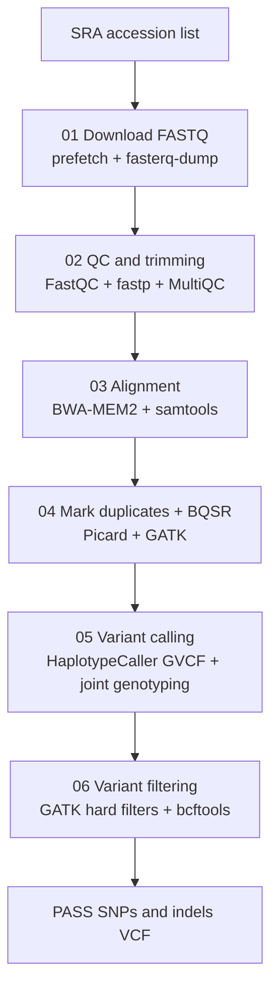

# GATK WGS Variant Calling Pipeline

An end-to-end, script-based pipeline for **whole genome sequencing (WGS)** analysis of paired-end Illumina data, from raw reads (NCBI SRA downloads or your own FASTQ files) to hard-filtered SNP and indel call sets, following the GATK germline short-variant workflow.

The pipeline is organism-independent. You supply the URL of a reference genome and of a known-variants VCF (variables at the top of scripts 03 and 04) plus a sample list, and the scripts do the rest. The GATK defaults assume diploid samples. For other ploidy, set `-ploidy N` (e.g. `-ploidy 4`) on both `HaplotypeCaller` and `GenotypeGVCFs`, using the same value in both. 

---

## Workflow



## Pipeline steps

| Script | Purpose | Main tools | Output |
|---|---|---|---|
| `01_download_fastq.sh` | Download paired-end reads from SRA | sra-tools (`prefetch`, `fasterq-dump`) | `raw/` |
| `02_preprocessing.sh` | Pre-trim QC, adapter/quality trimming, post-trim QC | FastQC, fastp, MultiQC | `trim/`, `qc/pre/`, `qc/post/` |
| `03_align.sh` | Download reference, index it, align reads, sort, index, alignment QC | BWA-MEM2, samtools, Picard, MultiQC | `reference/`, `align/` |
| `04_mark_duplicates_bqsr.sh` | Download known-sites VCF, mark duplicates, base quality score recalibration | Picard, GATK (`BaseRecalibrator`, `ApplyBQSR`), tabix | `markdup/`, `bqsr/` |
| `05_variant_calling.sh` | Per-sample GVCFs, combine, joint genotyping | GATK (`HaplotypeCaller`, `CombineGVCFs`, `GenotypeGVCFs`) | `variants/` |
| `06_variant_filtering.sh` | Split SNPs/indels, hard-filter, keep PASS variants, summary statistics | GATK (`SelectVariants`, `VariantFiltration`), bcftools, MultiQC | `filtered/` |

### Key settings

- **Trimming (fastp):** automatic paired-end adapter detection, poly-X trimming, overlap-based base correction, minimum Phred quality 20, minimum read length 50 bp.
- **Alignment:** `bwa-mem2 mem` with read groups (`ID` and `SM` set to the sample name, `PL:ILLUMINA`), coordinate-sorted with samtools.
- **Variant calling:** HaplotypeCaller in `-ERC GVCF` mode per sample, then `CombineGVCFs` and `GenotypeGVCFs` into a cohort VCF.
- **Hard filters:**

| Variant type | Filter |
|---|---|
| SNPs | `QD < 2.0`, `FS > 60.0`, `MQ < 40.0`, `MQRankSum < -12.5`, `ReadPosRankSum < -8.0` |
| Indels | `QD < 2.0`, `FS > 200.0`, `ReadPosRankSum < -20.0` |

## Requirements

- Linux (or macOS/WSL) with bash
- [conda](https://docs.conda.io/) or [mamba](https://mamba.readthedocs.io/)
- Tools: sra-tools, FastQC, fastp, MultiQC, BWA-MEM2, samtools, Picard, GATK4, bcftools, tabix (htslib), wget, GNU parallel (only for the optional parallel mode)

### Installation

```bash
git clone https://github.com/bushra-bibi-codes/complex-organisms-WGS-pipeline.git
cd complex-organisms-WGS-pipeline
```

**Option A: from `environment.yml` (recommended)**

```bash
conda env create -f environment.yml
conda activate gatk-wgs
```

**Option B: manual installation**

```bash
conda create -n gatk-wgs -c bioconda -c conda-forge python=3.11
conda activate gatk-wgs

conda install -c bioconda -c conda-forge fastqc fastp=1.3.3 bwa-mem2=2.2.1 samtools=1.23.1
conda install -c bioconda -c conda-forge openjdk=17 picard gatk4=4.6.2.0 bcftools=1.23.1
conda install -c bioconda -c conda-forge sra-tools tabix parallel wget
pip install 'multiqc<1.34'

# Clean the conda package cache to free disk space
conda clean --all -y
```

The setup follows the [BCH709 resequencing tutorial](https://bch709.plantgenomicslab.org/resequencing_tutorial/index.html) (CC BY 4.0).

### Verify the installation

```bash
fastp --version
bwa-mem2 version
samtools --version
gatk --version
bcftools --version
```

Expected output:

```
fastp 1.3.3
2.2.1
samtools 1.23.1
Using htslib 1.23.1
The Genome Analysis Toolkit (GATK) v4.6.2.0
bcftools 1.23.1
Using htslib 1.23.1
```

samtools 1.x or newer is required, because the scripts use the multithreaded `-@` option.

### Troubleshooting the installation

**`libcrypto.so.1.0.0: cannot open shared object file`** (raised by samtools or bcftools). The tools expect an older OpenSSL library than the one in the environment. Check which `libcrypto` exists and link it:

```bash
ls ${CONDA_PREFIX}/lib/libcrypto.so.*
# use the version you actually see (often libcrypto.so.3 or libcrypto.so.1.1)
ln -s ${CONDA_PREFIX}/lib/libcrypto.so.3 ${CONDA_PREFIX}/lib/libcrypto.so.1.0.0
```

**Conda hangs at "Solving environment".** The default solver can stall. Use mamba or the libmamba solver:

```bash
conda install -n base -c conda-forge mamba
# then use `mamba install` / `mamba env create` instead of `conda`
```

### Compute resources

The default thread and memory values in the scripts were set for a large workstation (about 450 GB RAM). Edit the variables at the top of each script to match your machine:

| Script | Variables |
|---|---|
| `02_preprocessing.sh` | `THREADS=20` |
| `03_align.sh` | `THREADS=40` |
| `04_mark_duplicates_bqsr.sh` | `JAVA_HEAP="25g"`, `GC_THREADS=2`, `PARALLEL_JOBS=12` |
| `05_variant_calling.sh` | `JAVA_HEAP="25g"`, `GC_THREADS=2`, `PARALLEL_JOBS=12` |
| `06_variant_filtering.sh` | `JAVA_HEAP="200g"`, `GC_THREADS=10`, `BCFTOOLS_THREADS=40` |

In the parallel modes, `PARALLEL_JOBS × JAVA_HEAP` must fit in your available RAM.

## Usage

Run all scripts **from the repository root**, in order.

1. **Set your reference data.** Edit `REF_URL` at the top of `scripts/03_align.sh` (reference genome FASTA, `.fasta.gz`) and `VCF_URL` at the top of `scripts/04_mark_duplicates_bqsr.sh` (known-sites VCF, `.vcf.gz`). See [Adapting to your dataset](#adapting-to-your-dataset).

2. **Create the sample list.** Create `SRR_Acc_List.txt` in the repository root, with one sample name per line. For data on NCBI SRA these are the run accessions:

   ```
   SRRxxxxxxx1
   SRRxxxxxxx2
   SRRxxxxxxx3
   ```

   If you already have FASTQ files, skip script 01: put them in `raw/` as `<sample>_1.fastq.gz` and `<sample>_2.fastq.gz`, and list the `<sample>` names in `SRR_Acc_List.txt` (scripts 04 and 05 read this list).

3. **Run the pipeline:**

   ```bash
   bash scripts/01_download_fastq.sh   # skip if you already have FASTQ files
   bash scripts/02_preprocessing.sh
   bash scripts/03_align.sh
   bash scripts/04_mark_duplicates_bqsr.sh
   bash scripts/05_variant_calling.sh
   bash scripts/06_variant_filtering.sh
   ```

Scripts 01, 04, and 05 each contain a commented-out **parallel mode** (GNU parallel / xargs). Uncomment it and disable the sequential loop to process several samples at once.

## Output structure

```
.
├── scripts/
├── SRR_Acc_List.txt
├── raw/             # downloaded FASTQ files
├── sra_cache/       # SRA prefetch cache
├── trim/            # trimmed reads + fastp reports
├── qc/
│   ├── pre/         # FastQC/MultiQC before trimming
│   └── post/        # FastQC/MultiQC after trimming
├── reference/       # reference FASTA, BWA-MEM2 index, .fai, .dict, known-sites VCF
├── align/           # sorted BAMs, flagstat, samtools stats
├── markdup/         # duplicate-marked BAMs + metrics
├── bqsr/            # recalibration tables + recalibrated BAMs
├── variants/        # per-sample GVCFs, cohort GVCF, cohort VCF
└── filtered/        # filtered VCFs and final PASS-only SNP and indel VCFs
```

Final results:

- `filtered/cohort.snps.pass.vcf.gz`
- `filtered/cohort.indels.pass.vcf.gz`

## Adapting to your dataset

- **Reference genome:** set `REF_URL` in `03_align.sh`. If you already have a FASTA locally, place it at `reference/reference.fasta` and remove the `wget` and `gunzip` lines.
- **Known sites for BQSR:** set `VCF_URL` in `04_mark_duplicates_bqsr.sh`. The VCF must be bgzip-compressed and use the **same contig names** as the reference FASTA; compare them with `bcftools view -h` and `samtools faidx`. If you already have the file locally, place it at `reference/known_variants.vcf.gz` and remove the `wget` line. If no validated variant resource exists for your organism, a common approach is to bootstrap one: call variants once without BQSR, hard-filter them to high-confidence sites, and use that VCF as known sites.
- **Ploidy:** GATK assumes diploid samples by default. For other ploidy, add `--sample-ploidy N` to `HaplotypeCaller` and `GenotypeGVCFs` in `05_variant_calling.sh`.
- **Very long chromosomes (2^29 bp, about 537 Mb, or more):** `.tbi` indexes cannot cover such contigs, and GATK cannot read `.csi` indexes. Scripts 05 and 06 detect this automatically from `reference/reference.fasta.fai`. In that case the GATK steps use uncompressed `.vcf` files with GATK `.idx` indexes (these need more disk space, so delete the intermediate `.g.vcf` and `.idx` files when you are done), and `cohort.vcf.gz` and the final PASS VCFs are bgzipped with `.csi` indexes. Otherwise the standard `.vcf.gz` + `.tbi` workflow is used.
- **Read group fields:** `LB` and `PU` are set to placeholders in `03_align.sh`. Edit them if your samples have multiple libraries or lanes.
- **Resources:** adjust the thread and memory variables at the top of each script (see [Compute resources](#compute-resources)).
- **Large cohorts:** `CombineGVCFs` works well for small to moderate sample numbers. For very large cohorts, consider replacing it with `GenomicsDBImport`.

Reads, reference genomes, and variant resources are not included in this repository. Check the terms of use of the sources you download from, and cite the original publications when you use them.

## Tools and citations

If you use this pipeline, please cite the tools it relies on, including GATK, BWA-MEM2, samtools and bcftools, Picard, fastp, FastQC, and MultiQC.

## Author

Bioinformatics analyst and genomics researcher.
GitHub: [@bushra-bibi-codes](https://github.com/bushra-bibi-codes)